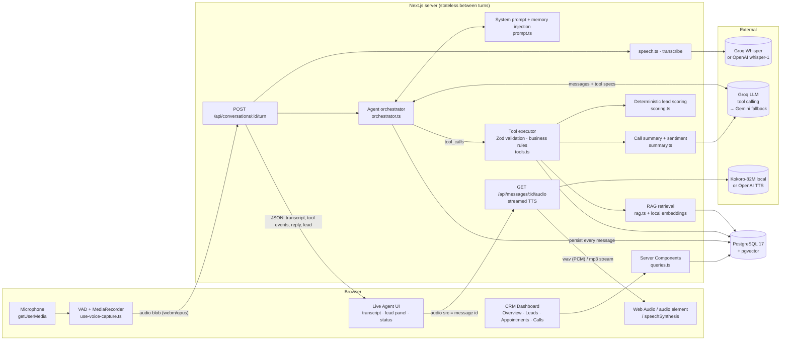
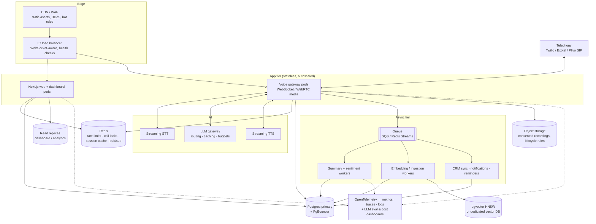

# Architecture

This document covers two things, kept separate:

1. **MVP architecture**: what is implemented in this repository.
2. **Proposed production architecture**: how it would scale to 100,000 registered users. None of that section is implemented.

---

## 1. MVP architecture (implemented)

A single Next.js application serves the dashboard UI and all backend logic as route handlers. Postgres with pgvector is the only stateful dependency. External AI services are called server-side over HTTPS.



### Request lifecycle of one turn

```
Browser                               Server                                   External
───────                               ──────                                   ────────
VAD detects speech → silence 1.2 s
MediaRecorder.stop() → Blob
POST /turn (multipart audio) ───────▶ rate limit · validate size/type
                                      transcribe() ───────────────────────────▶ Whisper
                                      silence/hallucination filter
                                      runTurn():
                                        lock conversation
                                        INSERT Message(USER)
                                        loop ≤5:
                                          build system prompt from DB memory
                                          chatCompletion(history, tools) ─────▶ Groq LLM
                                          if tool_calls:
                                            INSERT Message(ASSISTANT, toolCalls)
                                            for each: Zod.parse → run → INSERT Message(TOOL)
                                          else: INSERT Message(ASSISTANT, reply); break
◀──────────────────────────────────── JSON {transcript, toolEvents, reply, lead, appointment}
render transcript + lead panel
new Audio(/api/messages/:id/audio) ─▶ load message text by id
                                      synthesizeStream() ─────────────────────▶ Kokoro (local) / OpenAI
◀────────────── mp3 bytes streamed as they are generated ────────────────────
playback ends → resume listening
```

### Modules

| Concern | Where | Notes |
|---|---|---|
| **Audio capture** | `components/agent/use-voice-capture.ts` | `getUserMedia` with echo cancellation and noise suppression, then a Web Audio `AnalyserNode` that computes RMS every 50 ms. The noise floor is calibrated over 600 ms, with threshold = 3× floor. The MediaRecorder runs for the whole listening window so the first syllable isn't clipped. Speech means 150 ms above threshold; end of utterance means 1.2 s of silence, capped at 30 s. The recorder is recycled after 20 s idle. The mic is paused while the agent speaks to avoid echo. |
| **STT** | `lib/speech.ts` | Groq `whisper-large-v3-turbo` (default) or OpenAI `whisper-1`. A vocabulary prompt covers the localities, BHK, lakh and crore. Known Whisper silence hallucinations ("Thank you.") are dropped. |
| **Orchestrator** | `lib/agent/orchestrator.ts` | Stateless. Everything is loaded from Postgres each turn. History is the last 12 spoken messages (customer and agent text). Tool calls and results from earlier turns are not resent; their facts are in the memory block. The current turn's tool traffic is kept in full. Tools that can't apply are withheld, e.g. `book_appointment` until a slot is held. Tokens per turn are recorded on the reply message and logged. On the final step tools are withheld to force a spoken answer. An in-process lock prevents concurrent turns on one call. |
| **LLM** | `lib/agent/llm.ts` | OpenAI-compatible `/chat/completions`. The primary is Groq `gpt-oss-120b`. On a 429, a short wait (≤ 3 s) is retried on the same model; a longer one switches immediately to the next model in `LLM_FALLBACK_MODEL`. That's `gemini-2.5-flash` via Google's OpenAI-compatible API when `GEMINI_API_KEY` is set, otherwise Groq `gpt-oss-20b` (a separate per-model quota). Summaries run on `LLM_SUMMARY_MODEL`. Gemini requests use `max_tokens`, have thinking off (`reasoning_effort: none`) for latency, and drop empty tool parameters. It also retries once on 5xx and Groq's `tool_use_failed`. |
| **System prompt** | `lib/agent/prompt.ts` | Covers persona, voice style (short, no markdown, prices spoken as "lakh" and "crore"), the IST date and time, honesty rules, the workflow and booking-confirmation rules. It also carries the **memory block**: known fields, still-missing fields, previous enquiries, properties discussed and any pending booking. |
| **Tools** | `lib/agent/tools.ts` | Zod schema → `z.toJSONSchema` → LLM tool spec, so validation and spec come from one source. The spec sent to the LLM is compacted (one-line descriptions, validation-only keywords and nullable wrappers removed) to fit free-tier token budgets. The LLM never sees SQL or connection details; it can only request a named tool. Tool payloads are persisted but never sent to the browser. |
| **RAG** | `lib/rag.ts`, `lib/embeddings.ts` | Paragraph-aware chunking (~600 chars, one-paragraph overlap, title prefixed) → `all-MiniLM-L6-v2` (384-d, normalised, in-process ONNX) → `vector(384)` column → `ORDER BY embedding <=> $q`. `search_properties` applies **SQL filters first** (price, BHK, location, type, availability), then re-ranks by vector similarity when a descriptive `query` is given. If the embedder fails to load, Postgres full-text search runs instead and results are labelled `keyword_fallback`. |
| **Memory** | DB plus prompt injection | Short-term: the message history. Long-term: `Lead` requirements, `Customer` name and phone, previous `CallSummary` rows, `Conversation.propertiesDiscussed` and `pendingBooking`. A returning caller who gives their phone number is merged into the existing customer inside a transaction. |
| **Lead scoring** | `lib/scoring.ts`, `lib/leads.ts` | A pure function of the stated requirements and live inventory, recomputed on every lead update and booking. The breakdown and reasons are stored as JSON. |
| **Booking** | `lib/appointments.ts`, `book_appointment` | Visits run Mon–Sat in IST, hourly from 10:00 to 17:00, with at least 30 min notice and at most 60 days ahead. A booking has to pass four checks in order (see below). |
| **Summary + sentiment** | `lib/agent/summary.ts` | Facts come from the DB. The LLM (JSON mode, Zod-validated) writes only the narrative, the sentiment and reason, and follow-ups. Sentiment is written to `Conversation`, `Lead` and `CallSummary`. It is separate from the lead score and never feeds into it. |
| **Dashboard** | `app/(dashboard)`, `lib/queries.ts` | Server Components query Prisma directly. With Cache Components and Partial Prerendering, each page's shell is static and the DB-backed sections stream inside `<Suspense>`. Theming uses `next-themes` (class-based, light / dark / system) with CSS-variable status colours shared by badges and charts. |
| **TTS** | `GET /api/messages/:id/audio`, `lib/speech.ts` | Text is looked up by message id (never placed in a URL). Default: **Kokoro-82M (q8 ONNX) in-process** via `kokoro-js` on the shared transformers.js runtime. It needs no key and has no quota. Replies are synthesised one sentence at a time (serialised across requests), and each sentence's 24 kHz 16-bit PCM is sent after an open-ended WAV header. The client plays that stream with Web Audio (`components/agent/pcm-player.ts`), scheduling chunks as they arrive. An `<audio>` element would buffer ~4 s of it before starting. On this laptop CPU, first audio arrives in ~1.5–3 s and synthesis runs a little faster than real time. The model loads when `/api/health` is first called. With `OPENAI_API_KEY`, OpenAI `gpt-4o-mini-tts` (mp3 piped through to `<audio>`) is used instead. Gemini TTS is opt-in because its free tier is 10 requests/day. A 429 pauses it until the reset time it reports, and Kokoro serves those replies. Any hosted-provider failure falls back to Kokoro; if Kokoro itself fails, the route returns 503 and the browser's `speechSynthesis` speaks. IndicF5 (AI4Bharat) was evaluated and not used: it speaks only Indic languages (the agent is English), needs a Python/GPU sidecar, and is gated with no hosted API. |

**Booking checks.** `book_appointment` succeeds only if:
1. `check_appointment_availability` held this exact slot (`Conversation.pendingBooking`).
2. The confirmation arrives in a **later customer turn** than the offer.
3. `customer_confirmed=true`.
4. The customer's name is saved.

The insert itself is protected by `UNIQUE(propertySlotKey)` and `UNIQUE(customerSlotKey)`. A race surfaces as Prisma `P2002`, which returns `slot_taken` plus alternatives.

### Database design

```mermaid
erDiagram
  Customer ||--o| Lead : "has"
  Customer ||--o{ Conversation : "calls"
  Customer ||--o{ Appointment : "books"
  Conversation ||--o{ Message : "contains"
  Conversation ||--o| CallSummary : "summarised by"
  Conversation ||--o{ Appointment : "created"
  Property ||--o{ Appointment : "visited in"
  Property ||--o{ KnowledgeDocument : "described by"
  KnowledgeDocument ||--o{ KnowledgeChunk : "chunked into"

  Customer { uuid id PK; string name; string phone UK; bool isDemo }
  Lead { uuid id PK; uuid customerId UK; int budgetMaxInr; string preferredLocation; enum propertyType; int bedrooms; string timeline; int timelineMonths; enum buyingIntent; int score; enum classification; json scoreBreakdown; enum sentiment; enum stage }
  Conversation { uuid id PK; enum status; timestamptz consentGivenAt; timestamptz startedAt; int durationSec; enum sentiment; json pendingBooking; string[] propertiesDiscussed }
  Message { uuid id PK; enum role; text content; json toolCalls; string toolCallId; string toolName; int turnIndex; int latencyMs }
  Property { uuid id PK; string slug UK; string location; int priceInr; int bedrooms; enum propertyType; int areaSqft; string[] amenities; string availability; int unitsAvailable }
  Appointment { uuid id PK; timestamptz startsAt; timestamptz endsAt; string timezone; enum status; string propertySlotKey UK; string customerSlotKey UK }
  CallSummary { uuid id PK; uuid conversationId UK; json customerRequirements; text summary; int leadScore; enum leadClassification; enum sentiment; json propertiesDiscussed; json appointmentDetails; string[] followUpRecommendations }
  KnowledgeDocument { uuid id PK; string title; enum sourceType; text content }
  KnowledgeChunk { uuid id PK; int chunkIndex; text content; vector384 embedding }
```

Design notes:
- **Lead vs Customer.** `Customer` holds identity; `Lead` holds the *current* qualification (1:1). Each call's snapshot is frozen in `CallSummary`, so history is preserved while the lead stays current.
- **Prices** are stored as whole rupees in `Int`. The maximum (~₹214 Cr) is ample for residential stock.
- **Tool messages** are stored with `toolCallId` so the exact LLM context can be rebuilt on every turn and after a restart.
- **Vector index.** There isn't one yet: 26 chunks are scanned exactly in under 1 ms. Production would add HNSW (see below).
- **Demo data.** `isDemo` separates seeded rows. The seed only deletes and recreates demo rows.

### Security and reliability (MVP)

- **API keys:** read only in `lib/env.ts` (`server-only`). The browser receives only booleans from `/api/health`.
- **Consent:** `POST /api/conversations` requires `{ consent: true }`, and `consentGivenAt` is stored on the conversation.
- **Validation:** Zod on every request body and every tool call. Request ids must be UUIDs. Audio is capped at 10 MB and text at 1,000 characters.
- **Rate limits:** in-memory, per IP. Create: 10/min. Turn: 30/min. End: 10/min. TTS: 60/min.
- **Logging:** only error class, code and status. No transcripts, phone numbers or request bodies.
- **Failure modes:** a missing key returns `503 not_configured` with the variable name. LLM 429s return `429`. Tool exceptions are turned into a safe tool result so the agent can apologise and offer a callback.

---

## 2. Proposed production architecture (100,000 registered users) — *not implemented*

**Assumptions.** 100k registered users, ~5% active daily, so ~5,000 calls/day. Peak is ~10× the average hour, giving **~150–300 concurrent calls**. A call averages 4 minutes and ~10 turns.



### Horizontal scaling and stateless app servers
- The MVP is already stateless per turn: all conversation state lives in Postgres. The remaining in-process state is the rate-limit map and the turn lock, and both move to **Redis** (`INCR` + `EXPIRE` for limits; `SET key NX PX` for per-call locks).
- Split into two deployables. **Web/dashboard** is short HTTP requests; it scales on CPU and RPS. The **voice gateway** holds long-lived WebSocket/WebRTC sessions; it scales on concurrent sessions per pod (e.g. 50–100 per pod).
- Autoscale with Kubernetes HPA or ECS service autoscaling, using custom metrics (active sessions, queue depth).

### Load balancing
- An L7 load balancer with WebSocket support and connection draining on deploy. Voice sessions don't need sticky routing because state lives in Redis and Postgres; only the socket itself is pinned to a pod.
- Health checks use `/api/health`, extended to cover Redis and queue reachability.

### Real-time voice (removing the MVP's turn-based limitation)
- Replace upload-per-turn with a **bidirectional WebSocket or WebRTC** media stream to the voice gateway.
- **Streaming STT** with partial transcripts and server-side VAD/endpointing.
- **Streaming LLM tokens**, split into sentences and sent to **streaming TTS**, so the first audio plays within ~1 s.
- **Barge-in:** cancel TTS playback and the in-flight LLM call when the customer starts speaking.

### Telephony integration
- A SIP trunk or programmable voice provider (Twilio, Exotel or Plivo for India) streams call audio over WebSocket (μ-law, 8 kHz) to the same voice gateway. The agent and tool layer are channel-agnostic, since `Conversation.channel` already exists.
- Caller ID gives the phone number up front, so `get_customer_history` runs before the greeting.
- Compliance: DND/TRAI rules for outbound calls, a recorded consent prompt at call start, and warm transfer to a human agent (SIP REFER) on request or when the agent is uncertain.

### Message queues and background workers
Anything not needed for the next spoken sentence leaves the hot path:
- Call summary and sentiment generation (currently synchronous at end of call).
- Re-embedding when listings change; bulk document ingestion.
- CRM sync, WhatsApp/SMS visit confirmations and reminders 24 h before.
- Analytics roll-ups.

Use idempotent jobs keyed by conversation id, with retries and a dead-letter queue.

### Database optimisation
- **PgBouncer** (transaction pooling). The Prisma pool is sized per pod so that pods × pool stays under the PgBouncer limit.
- **Read replicas** for dashboard and analytics queries; the primary serves writes and the call hot path.
- **Indexes:** the MVP has `(location, bedrooms, priceInr)`, `Message(conversationId, createdAt)`, `Conversation(startedAt)` and `Lead(classification)`. Add an **HNSW index** on `KnowledgeChunk.embedding` (`vector_cosine_ops`) once the chunk count reaches the thousands.
- **Partitioning:** partition `Message` by month (it's the fastest-growing table, ~10 rows per turn), with archival to object storage.
- **Pre-aggregation:** materialised views or a nightly roll-up table for overview KPIs instead of live `COUNT`s.
- **Pending bookings:** short-lived slot holds move to Redis with a TTL. The DB unique constraints stay as the final guarantee.

### Redis (summary of uses)
Rate limiting, per-call locks, short-lived slot holds, caching of hot reads (property catalogue, embeddings of frequent queries), pub/sub to push live call events to supervisor dashboards, and session presence for the voice gateway.

### Monitoring and observability
- **OpenTelemetry tracing** across one turn (STT → LLM steps → each tool → TTS), with per-stage latency histograms. The MVP already records `latencyMs` for STT and the agent loop per message.
- **SLOs:** p95 time-to-first-audio under 1.5 s; tool error rate under 1%; booking success rate.
- **Business metrics:** calls, HOT-lead rate, visit conversion, drop-off turn.
- **LLM quality:** sampled transcripts are scored offline (hallucinated properties, booking without confirmation, repeated questions) and gate any prompt or model change. Alerts fire on provider error rates and on queue lag.
- **Logs:** structured logs with PII redaction. Recordings are stored only with consent, under retention policies.

### AI inference costs
Rough per-call cost (10 turns, ~4 min audio, ~2.5k prompt tokens per LLM step, ~2 steps per turn) is dominated by **TTS and LLM input tokens**.

Levers:
- **Prompt caching** of the static system-prompt prefix, where the provider supports it.
- **Trim tool results:** pass compact JSON to the LLM, as the MVP already does with `propertyForLLM`.
- **Model routing:** a small, fast model for routine turns and a larger one for summaries and complex objections.
- **Cache TTS** for fixed phrases (greeting, standard confirmations).
- **Self-hosted Whisper/TTS on GPUs** once volume justifies it; compare against per-minute API pricing.
- **Budgets:** per-tenant and per-call token budgets with hard caps in an LLM gateway; cost dashboards per model and per feature.
- **Batch work:** summaries and re-embeddings run as background jobs where cheaper batch pricing exists.

### What stays the same
The tool contract (Zod-validated, DB-enforced business rules), the deterministic scoring, the DB-backed duplicate protection and the "facts from DB, narrative from LLM" summary design all carry over unchanged. Scaling changes the transport and the infrastructure, not the business logic.
