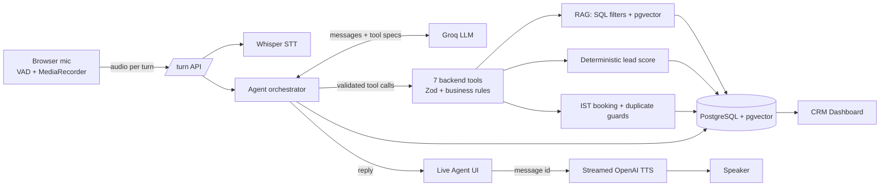

# EstateAI Voice Sales Agent — Project Report

**What it is.** A working MVP of an autonomous AI sales agent for *EstateAI*, a fictional real estate company in Pune. A customer speaks to the agent ("Akash") in the browser. The agent:
- understands their requirements
- recommends real listings from the database
- qualifies and scores the lead
- books a site visit after explicit confirmation
- writes a call summary

Everything appears live in a CRM dashboard.

**Stack.** Next.js 16 (App Router) · TypeScript · Tailwind + shadcn/ui · PostgreSQL 17 + pgvector · Prisma 7 · Zod · Groq (LLM + Whisper STT) · OpenAI TTS · local MiniLM embeddings · Recharts.

## Architecture

- **Pipeline:** microphone → voice activity detection → Whisper STT → orchestrator (LLM ⇄ tools, up to 5 steps) → reply → streamed TTS playback. It is turn-based; TTS audio streams so playback starts early.
- **Stateless server:** every message, including tool calls and results, is stored in Postgres. Each turn rebuilds the context from the DB, plus a *memory block* in the system prompt (known requirements, missing fields, past calls, properties discussed, pending booking). A page refresh resumes the call.
- **Tools:** `search_properties`, `search_company_knowledge`, `get_customer_history`, `save_or_update_lead`, `check_appointment_availability`, `book_appointment`, `generate_call_summary`. The LLM never touches the database; it requests tools by name, and every argument set is Zod-validated.
- **RAG:** hard constraints (price, BHK, location) are SQL. Soft preferences use vector similarity over 384-dim embeddings stored in pgvector. A labelled keyword fallback exists if the embedder is unavailable.

## Key design decisions

| Decision | Why |
|---|---|
| **Deterministic lead score** (budget 30 + timeline 30 + intent 25 + match 15) → HOT ≥ 75 / WARM / COLD | Auditable, repeatable, no prompt-injection surface. The LLM only extracts the inputs. |
| **Confirmation enforced in code** | `book_appointment` needs a slot held by an earlier availability check, a later customer turn, `customer_confirmed=true` and a saved name. |
| **Duplicate bookings blocked by the DB** | `UNIQUE` slot keys per property and per customer: races fail with `P2002` and the agent offers alternatives. |
| **Facts from the DB, narrative from the LLM** | Summaries take requirements, score, properties and appointment from Postgres. The LLM writes only the prose, sentiment and follow-ups. |
| **Sentiment kept separate** from lead scoring | Customer mood shouldn't distort qualification. |

## Data model

`Customer` 1–1 `Lead` · `Customer` 1–* `Conversation` 1–* `Message` · `Conversation` 1–1 `CallSummary` · `Appointment` → `Customer` / `Property` / `Conversation` · `KnowledgeDocument` 1–* `KnowledgeChunk` (`vector(384)`). UUID keys, `timestamptz`, and an `isDemo` flag separating seeded rows from live calls.

## Status & verification

- **Built:** voice UI with consent gate, typed fallback, resume after refresh, and a pipeline-status panel. Dashboard pages: Overview (KPIs, lead and sentiment charts), Live Agent, Leads, Appointments and Call History. Rate limiting, server-only keys and PII-free logs.
- **Checks:** `typecheck`, `lint` and `build` pass. `npm run test:tools` exercises the full booking workflow and its safeguards against the real DB.
- **Verified with a scripted LLM stand-in:** the end-to-end demo flow ran through the API: "3BHK in Baner under 1 Cr" → 2 matches → lead 45 WARM → 100 HOT → slot held → booked on "yes" → summary saved → visible in the dashboard.
- **Not yet verified:** a live call with the real model and a microphone.

## Limitations & next steps

- **Turn-based voice:** no barge-in and no streamed STT/LLM. Next step: WebSocket/WebRTC with streaming STT → LLM → TTS.
- **Groq free tier (8K tokens/min, 200K/day):** throttles calls to about one turn per minute and roughly 3 calls a day. Use the Developer plan for demos.
- **Single-instance state:** the rate limiter and turn lock are in memory. Next step: move both to Redis.
- **No dashboard authentication.**
- **Scaling to 100k users** ([ARCHITECTURE.md §2](ARCHITECTURE.md)): stateless pods with Redis, a separate voice gateway, a queue with background workers, PgBouncer plus read replicas, HNSW indexing, telephony over SIP, and OpenTelemetry tracing.

*Further detail: [README](../README.md) · [Architecture](ARCHITECTURE.md) · [API](API.md) · [Demo & Q&A](DEMO.md)*
